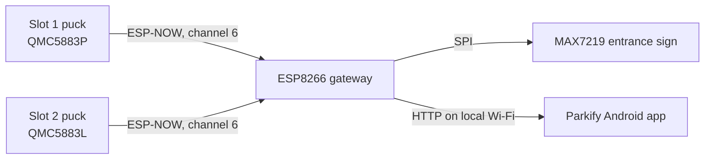

# Parkify


**A two-slot smart-parking prototype combining magnetic sensing, an entrance display, and a Flutter app.**

Maker Challenge 2026 · CFAL Makers' Fete · Team Axiom Labs: Raif and Anwesh

[](https://www.espressif.com/en/products/socs/esp8266)
[](https://flutter.dev)
[](#current-scope-and-limitations)

Parkify detects whether a parking space is occupied by measuring changes in the local magnetic field. Two ESP8266 sensor pucks send slot states to a gateway over ESP-NOW. The gateway updates a MAX7219 LED matrix and serves a small HTTP API to the Android app over the local Wi-Fi network.

> **Project status:** Maker Challenge prototype. The hardware and app are configured for two live slots. This repository does not include a cloud service or production deployment setup.

## At a glance

- **Sensors:** QMC5883P (slot 1) and QMC5883L (slot 2)
- **Radio:** ESP-NOW on Wi-Fi channel 6
- **Gateway:** ESP8266 with a fixed local IP and HTTP status/recalibration endpoints
- **Display:** MAX7219 FC-16 32×8 LED matrix
- **App:** Flutter Android app; demo mode is enabled by default
- **Network:** Local Wi-Fi only; internet access is not required for the prototype

## How it works



Each puck records an empty-slot baseline at startup. It compares the current magnetic-field magnitude with that baseline and applies separate occupied/free thresholds to reduce state flicker. The gateway displays a tick for a free slot and a cross for an occupied slot, and exposes the latest states to the app.

## Repository layout

```text
firmware/
  gateway.ino       ESP8266 gateway, LED sign, and HTTP API
  puck1.ino         Slot 1 firmware for QMC5883P (I²C 0x2C)
  puck2.ino         Slot 2 firmware for QMC5883L (I²C 0x0D)
app/
  lib/              Flutter application source
  assets/           Fonts and app artwork
  android/          Android project files
```

## Hardware

| Component | Quantity | Purpose |
|---|---:|---|
| ESP8266 NodeMCU | 3 | Two sensor pucks and one gateway |
| QMC5883P magnetometer | 1 | Slot 1 sensor, I²C address `0x2C` |
| QMC5883L magnetometer | 1 | Slot 2 sensor, I²C address `0x0D` |
| MAX7219 FC-16 32×8 matrix | 1 | Gateway-driven entrance sign |
| Local Wi-Fi router | 1 | Network between gateway and phone |
| Android phone | 1 | Runs the Parkify app |

### Sensor wiring

Use the same NodeMCU wiring for each puck:

| Magnetometer | NodeMCU |
|---|---|
| VCC | 3V3 |
| GND | GND |
| SDA | D2 |
| SCL | D1 |

### LED matrix wiring

| MAX7219 matrix | Gateway NodeMCU |
|---|---|
| VCC | VIN |
| GND | GND |
| DIN | D7 |
| CLK | D5 |
| CS | D2 |

## Build and configure

### 1. Prepare the firmware environment

Install the ESP8266 board package in Arduino IDE and select the NodeMCU ESP8266 board. Install the **MD_Parola** and **MD_MAX72XX** libraries for the gateway sketch. The puck sketches use the ESP8266 core's ESP-NOW and I²C support.

Open each `.ino` file from `firmware/` as its own sketch. Upload `puck1.ino` and `puck2.ino` to their respective sensor boards, then upload `gateway.ino` to the board connected to the matrix.

### 2. Configure the local network

Before uploading the gateway sketch, set the network values near the top of `firmware/gateway.ino`:

- `WIFI_SSID` and `WIFI_PASS`: credentials for the local router
- `GW_IP`, `ROUTER_IP`, and `SUBNET`: addresses that match the router's network

The defaults are gateway `192.168.1.50`, router `192.168.1.1`, and subnet `255.255.255.0`. Change them if your router uses a different network. If you change the gateway IP, also update `gatewayUrl` and the recalibration URL in `app/lib/controller.dart`.

The pucks are configured for channel 6 (`WIFI_CH`). Set the router's 2.4 GHz network to channel 6, and keep the gateway and both pucks on that channel so ESP-NOW messages can reach the gateway. The puck sketches contain a `GATEWAY_MAC` value; it must match the gateway board's station MAC address. The gateway prints its MAC, channel, and IP address to the Serial Monitor at 115200 baud.

**Keep real Wi-Fi credentials out of source control.** The committed gateway sketch contains placeholders. Replace them only in your local working copy.

### 3. Calibrate and tune the sensors

On startup, each puck averages readings while the slot is empty. Keep the sensor still and move the car and magnets away during calibration. The current firmware uses `T_ON = 8 µT` and `T_OFF = 4 µT`, with 60 ms occupied and 400 ms free confirmation periods. These are starting values; tune them against the actual sensor placement and demo vehicle.

To recalibrate, use the app's **Recalibrate** control or type `c` in the puck's Serial Monitor. Recalibration requires the slot to be empty.

### 4. Run the Android app

Install a Flutter SDK compatible with the constraints in `app/pubspec.yaml`, connect an Android phone to the same local network, then run:

```bash
cd app
flutter pub get
flutter run
```

The app starts in **Demo mode**. Turn Demo mode off in the app's hardware/developer settings to read live gateway data. The Android manifest permits cleartext HTTP because the ESP8266 serves HTTP on the local network; this prototype does not provide TLS or API authentication.

## Gateway API

| Request | Response / behavior |
|---|---|
| `GET /status` | Returns slot states and the free-slot count as JSON. |
| `GET /recalibrate?slot=1` | Requests recalibration for slot 1. |
| `GET /recalibrate?slot=2` | Requests recalibration for slot 2. |
| `GET /recalibrate?slot=0` | Broadcasts a recalibration request to both pucks. |

Example status response:

```json
{"slots":[{"id":1,"taken":false},{"id":2,"taken":true}],"free":1}
```

You can check the endpoint from a browser on the same network at `http://192.168.1.50/status`, provided the gateway is using its default IP address.

## Current scope and limitations

- The firmware, status response, and app's live polling are configured for two slots.
- Only the Nexus Mall entry in the app is marked as the live pilot; other listed locations are placeholders and are not connected to sensors.
- The gateway uses a fixed local IP address and the puck firmware is configured for Wi-Fi channel 6.
- The app communicates with the gateway over unauthenticated HTTP on the local network. This setup is for a controlled prototype, not an internet-facing or production deployment.
- Magnetic thresholds depend on the sensor, enclosure, nearby metal, and vehicle. Field calibration and testing are required for each installation.
- No license has been selected for this repository. Contact the team before reusing or redistributing the code.

## Troubleshooting

| Symptom | Checks |
|---|---|
| App shows the gateway as offline | Confirm Demo mode is off, phone and gateway are on the same network, and the configured gateway IP matches `controller.dart`. Open `/status` from the phone's browser. |
| Puck state never reaches the gateway | Confirm the router's 2.4 GHz channel is 6, `GATEWAY_MAC` matches the gateway station MAC, and the gateway joins Wi-Fi successfully. |
| Slot state flickers or triggers too easily | Recalibrate with the slot empty; then tune `T_ON`, `T_OFF`, `ON_MS`, and `OFF_MS` for the physical setup. |
| Sensor initialization fails | Check 3V3/GND and I²C wiring, then verify that the sensor address and sketch match the module (slot 1: `0x2C`; slot 2: `0x0D`). |
| LED matrix is blank or mirrored | Check VIN, GND, DIN, CLK, and CS wiring; review `HW_TYPE` and `FLIP` in `gateway.ino`. |

## Contributing

Issues and focused pull requests are welcome. Include the affected board or app screen, steps to reproduce, expected behavior, and relevant error output. Remove Wi-Fi passwords and other private credentials before sharing logs or configuration.

## Credits

Built by Team Axiom Labs — Raif and Anwesh — for the Maker Challenge 2026 at CFAL Makers' Fete.